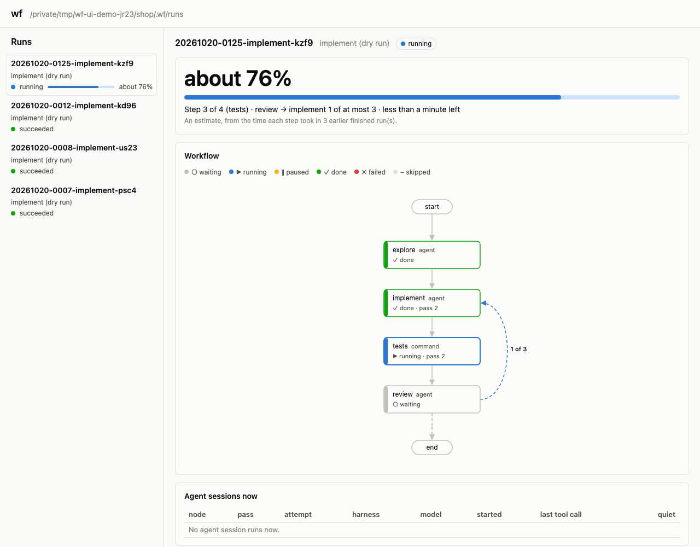

# wf

Run YAML workflows of coding-agent steps.

A workflow is a graph of steps.
Its steps are tasks for coding agents (Claude Code, Codex or Cursor), shell commands, questions for a person, and other workflows.
Every step declares what it outputs, and routes decide what runs next.
So loops like "implement, test, review, and go round until clean" are a few lines of YAML.
wf runs the graph on LangGraph:
- parallel steps work in their own git worktrees;
- a failed attempt is retried, or falls back to another agent;
- limits cap a run's cost, tokens and time;
- any run can pause for a person and be answered later, from a terminal or by
  an autonomous operator.

One cap on live agent sessions holds across all your runs that share a `~/.wf`.
Agents can also read Slack, Granola, Linear, Notion and Gmail through tools that wf brings itself.

## Install

Needs Python 3.13, [uv](https://docs.astral.sh/uv/), and Claude Code, Codex or Cursor set up.
Cursor runs through Cursor's SDK, so it needs Node.js 22.18 or later and a Cursor API key (`wf runtimes cursor signin`).
Its `edit` steps run through `cursor-agent`, logged in.
Until a key is set, all its steps run through `cursor-agent`, and each run warns once.

```sh
uv tool install --editable .
```

## Quick start

```sh
wf examples                              # copy two complete workflows into ./wf-examples
wf validate wf-examples/implement.yaml   # check the wiring before anything runs
wf graph wf-examples/implement.yaml      # see it as a Mermaid diagram
wf run wf-examples/implement.yaml task="Add a --version flag"
wf report --workflow implement           # what the runs did, per step
wf trace <run-id> --var review.blocking_issues   # what one run's templates read, pass by pass
```

`wf steer <run-id> <node> <message>` tells an agent something while it works.
Claude Code and Codex agents read it at their next step, and so does Cursor when its SDK takes the message.
When an agent can't take it during a turn, wf keeps it for the next turn.
wf drops it when the agent submits its result first, which is common.

`wf run <file> --dry-run <script.yaml>` walks a workflow with scripted agent
results, for free. `wf --help` lists every command.

`wf retry <run-id>` continues a failed or paused run, or a run that a limit stopped,
from its last checkpoint. Steps and items that finished don't run again.
When a model fails again and again, `--model` gives that step, or one item of it, another model for the rest of the run:

```sh
wf retry <run-id> --harness 'review[2]=claude-code' --model 'review[2]=claude-opus-5-5'
```

`wf continue <run-id> "<request>"` gives a run that succeeded a follow-up request.
The run goes on from the node that its workflow's `follow_up` names, on the same branches and agent sessions.
Without `follow_up`, the first agent node with `edit` or `full` access takes the request.
Then wf adds the request to the instruction of that node.
Its routes count from zero again, and `--limit` gives it a budget of its own.

Steps that read Slack, Granola, Linear, Notion or Gmail list them in `tools`.
Sign in to each once per machine:

```sh
wf tools list                            # each tool, and whether it's set up
wf tools slack setup                     # sign in; the secret goes to the macOS Keychain
wf tools doctor                          # check that every tool you set up works
```

## Watch a run

`wf status` says how far a run is: its step on the way from start to end, the times each loop went back, and a percentage.
The percentage is an estimate.
Until earlier finished runs show how long each step takes, wf counts each loop as if it goes back up to its `max`.
Then it gives the time left too.

```sh
wf status <run-id>     # step 3 of 4 (tests), review → implement 1 of at most 3, about 38%
wf sessions            # each agent session that runs now: node, harness, model, last tool call, quiet time
wf watch <run-id>      # the run's steps and tool calls as they come, until it succeeds: keep it open in a pane
wf ui                  # a web page on 127.0.0.1 with all of it, at the address that it prints
```

The `wf status` line above is for a run of `implement.yaml` with no earlier finished runs, at its tests for the second time.

`wf ui` is a small web page that wf serves on your machine only.
It lists the runs of the repo.
For each run it draws the workflow graph, with the state of each step.
It also shows the progress, the numbers of `wf report` for each step with its state, the live events, and each session's transcript and instruction.
A step that runs shows what it has done so far: its attempts, its time, and its tokens and cost.
It gets new data on its own: the run every 2 seconds, its events every second, and the list of runs every 5 seconds.
It needs no build step and no other service.
The address that `wf ui` prints holds a key, so other programs and users on the machine can't read the runs through it.



## Metrics in Grafana

`wf metrics up` starts the metrics stack of `metrics/compose.yaml` in Docker, and prints the address of Grafana.
The stack has three services:
- an OpenTelemetry Collector, which takes OTLP from Claude Code and Codex on ports 4317 and 4318
- ClickHouse, which keeps that data in the database `otel`, and the tables of wf runs in the database `wf`
- Grafana, whose home page is the dashboard "wf runs", on port 3000

wf doesn't write the tables of `wf` yet, so the dashboard stays empty for now.
`wf metrics up` needs Docker with Compose, and wf installed from its checkout, because the stack is part of wf's source.
A start with new volumes also needs the internet, for the images and for Grafana's ClickHouse plugin.
The stack doesn't start again by itself when Docker starts again, so then run `wf metrics up` again.
`docker compose -f metrics/compose.yaml down` stops the stack, and `down -v` also deletes its data.

Each port listens on 127.0.0.1 only.
Grafana has no login, and ClickHouse has the fixed user `wf` with the password `wf`.
So each user and program on this machine can read and change the data of the stack.
ClickHouse takes the user and password over HTTP only in the headers `X-ClickHouse-User` and `X-ClickHouse-Key`, so a web page can't send it statements.
To move a port, set `WF_METRICS_GRAFANA_PORT`, `WF_METRICS_CLICKHOUSE_PORT`, `WF_METRICS_OTLP_GRPC_PORT` or `WF_METRICS_OTLP_HTTP_PORT`.
With 0, Docker picks a free port, and `docker compose -f metrics/compose.yaml port <service> <port>` names it.

## Docs

- [docs/workflow-spec.md](docs/workflow-spec.md): the file format, and how runs behave.
- [docs/tools.md](docs/tools.md): the tools agents can use, how each signs in, and which of their operations count as reads.
- [skills/wf-workflows](skills/wf-workflows/SKILL.md): an agent skill for building,
  changing and improving workflows.
- [integrations/firstmate](integrations/firstmate/README.md): let
  [firstmate](https://github.com/kunchenguid/firstmate)'s first mate run and
  supervise wf runs.
- [docs/research/harness-adapters.md](docs/research/harness-adapters.md): how each
  coding agent is driven.
- The code is meant to be read: `workflow/__init__.py` gives the order.

## Status

Claude Code, Codex and Cursor are supported.
Tools attach to sessions on all three.

## Development

```sh
uv run pytest                  # fake agents, no cost
uv run pytest -m harness       # real agents: uses your Claude Code, Codex and Cursor quota
```

Where Docker answers and grafana.com can be reached, `uv run pytest` also starts the metrics stack in a compose project of its own.
The tests remove it at the end.
A `-m` of your own replaces the default `-m 'not harness'`, so leave those tests out with `-m 'not harness and not docker'`.

The tests of Cursor's runtime run the real Cursor host on a fake Cursor SDK, so they need Node.js 22.18 or later.
The host has its own TypeScript checks: `npm ci && npm run check && npm test` in `workflow/harnesses/cursor_host`.

The tests need git 2.34 or later: they hide your own git config with `GIT_CONFIG_GLOBAL` (2.32), and sign with ssh keys (2.34).
